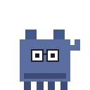
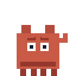
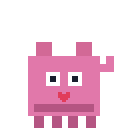
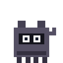

<div align="center">

# 🐾 Desktop Buddy

**Little pixel companions that live on your desktop — they walk along your windows, climb the edges of your screen, chat about what you're working on, and occasionally steal things.**


<table>
  <tr>
    <td align="center"><br><b>Coder Cat</b></td>
    <td align="center"><br><b>Roaster</b></td>
    <td align="center"><br><b>Love Guru</b></td>
    <td align="center"><br><b>Thief</b></td>
  </tr>
</table>

</div>

---

## ✨ Features

- **Real desktop physics.** Characters fall with gravity, land on the top edges of your open windows, walk along them, and climb window and screen edges.
- **Pick them up and throw them.** Drag a character anywhere with the mouse and fling it. A hard landing leaves it dizzy for a moment.
- **Context-aware chatter.** Speech bubbles react to the foreground window. They know whether you're in a browser, a terminal or an editor, and which language you're writing (Rust, TypeScript, Python, Go and more).
- **Distinct personalities.** Each character behaves differently around your cursor (see below).
- **Lives in the system tray.** A small panel lets you spawn, remove, import and delete characters. No main window gets in the way.
- **Import classic Shimeji packs.** Drop in any community Shimeji-ee `.zip` and it's converted automatically.
- **Remembers who was on screen.** Your active characters come back the next time you launch the app.
- **Lightweight.** Built with Tauri, so it uses a tiny native binary instead of a bundled browser.

## 🎭 Meet the cast

| Character | Personality | Around your cursor | Signature move |
|---|---|---|---|
| **Coder Cat** | Helpful pair programmer | Minds its own business | Drops keyboard shortcuts and coding tips for the app you're using |
| **Roaster** | Brutally honest critic | Chases it | Roasts your tabs, your Stack Overflow habit and your code |
| **Love Guru** | Hopeless romantic | Runs away from it | Showers you with sweet encouragement |
| **Thief** | Kleptomaniac | Chases it | Snatches a little patch of a nearby window and carries it around 🫣 |

## 🚀 Getting started

There are no prebuilt installers yet, so build the app from source. It only takes a few minutes.

### Prerequisites

| Tool | Version | Get it |
|---|---|---|
| Node.js | 18 or newer | [nodejs.org](https://nodejs.org/) |
| Rust | stable | [rustup.rs](https://rustup.rs/) |
| Tauri system deps | — | [Tauri prerequisites](https://v2.tauri.app/start/prerequisites/) (WebView2 on Windows, Xcode CLT on macOS, `webkit2gtk` on Linux) |

### Run it

```bash
git clone https://github.com/samay312006/desktop_buddy.git
cd desktop_buddy
npm install
npm run tauri dev
```

The first launch compiles the Rust side, which takes a few minutes. Later launches are fast.

### Build an installer

```bash
npm run tauri build
```

Installers are written to `src-tauri/target/release/bundle/`: `.msi` / `.exe` on Windows, `.dmg` / `.app` on macOS, and `.deb` / `.AppImage` on Linux.

## 🕹️ How to use

1. Launch the app. The app icon appears in the **system tray** (on Windows, check the `^` overflow area).
2. **Left-click** the tray icon to open the panel.
3. Under **Characters**, click **+** to put a buddy on your screen. Add as many as you like.
4. Under **Running**, click **✕** to send a buddy home.
5. Click **🗑** next to a character to delete it from your library.
6. **Drag** any character to move it, and release with some speed to throw it.
7. **Right-click** the tray icon → **Quit Shimeji** to close everything.

## 📦 Adding more characters

### Import a Shimeji pack

Thousands of community Shimeji characters exist online. To add one:

1. Open the tray panel and click **+ Add Character**.
2. Pick the character's `.zip` file. It should contain frames named `shime1.png … shimeN.png`.
3. The app packs the frames into a spritesheet, writes a manifest for it, and adds it to your list.

A tiny sample pack, [`Neko-Test.zip`](Neko-Test.zip), is included so you can try it out.

### Where characters live

All characters are stored in your home folder:

```
~/shimeji/characters/<character-id>/
├── manifest.json     # animations + behaviour settings
├── spritesheet.png   # all frames in a grid
└── preview.png       # thumbnail shown in the panel
```

Click **Open Folder** in the panel to jump there, and **Reload** after editing files by hand.

### Make your own

Create a folder with the three files above. The spritesheet is a grid where each **row** is one animation:

```jsonc
{
  "id": "my-buddy",
  "name": "My Buddy",
  "author": "you",
  "version": "1.0.0",
  "personality": "coder",          // coder | roaster | love | thief
  "frameWidth": 64,
  "frameHeight": 64,
  "fps": 8,
  "scale": 2,
  "animations": {
    "idle":       { "row": 0, "frames": 4, "loop": true },
    "walk_right": { "row": 1, "frames": 6, "loop": true },
    "walk_left":  { "row": 2, "frames": 6, "loop": true },
    "fall":       { "row": 3, "frames": 2, "loop": true },
    "climb_up":   { "row": 4, "frames": 4, "loop": true },
    "climb_down": { "row": 5, "frames": 4, "loop": true },
    "sit":        { "row": 6, "frames": 2, "loop": true },
    "grabbed":    { "row": 7, "frames": 2, "loop": true },
    "thrown":     { "row": 8, "frames": 2, "loop": false }
  },
  "behaviors": {
    "gravity": 0.5,
    "walkSpeed": 1.5,
    "climbSpeed": 1,
    "canClimb": true,
    "canSit": true,
    "sitChance": 0.002,
    "turnChance": 0.001,
    "speakChance": 0.004
  }
}
```

`scripts/gen-characters.mjs` (run with `npm run gen:characters`) is the generator used for the built-in sprites. It's a good starting point for procedurally drawn characters.

## 🖥️ Platform support

| | Windows | macOS | Linux |
|---|:---:|:---:|:---:|
| Walking, falling, screen-edge climbing, drag & throw | ✅ | ✅ | ✅ |
| Speech bubbles and personalities | ✅ | ✅ | ✅ |
| Standing on and climbing **other app windows** | ✅ | 🚧 | 🚧 |
| Thief stealing window patches | ✅ | 🚧 | 🚧 |

Window detection and screen capture currently use native Win32 APIs. On macOS and Linux, characters treat the screen edges as the world. Contributions for those platforms are very welcome.

## 🧱 Project structure

```
desktop_buddy/
├── src/                        # React + TypeScript frontend
│   ├── character/              # behaviour engine, animation, sprite renderer, speech bubble
│   ├── speech/speechPacks.ts   # personality lines + app/language detection
│   └── tray/TrayPanel.tsx      # tray control panel
├── src-tauri/                  # Rust backend
│   └── src/
│       ├── lib.rs              # app setup, tray, character windows
│       ├── ipc.rs              # commands exposed to the frontend
│       ├── character_manager.rs# loading/saving characters
│       ├── importer.rs         # Shimeji-ee .zip → spritesheet converter
│       └── window_manager.rs   # native window enumeration & capture
├── characters/                 # built-in characters (embedded into the binary)
└── scripts/                    # sprite generators
```

## 🤝 Contributing

Issues and pull requests are welcome, especially new characters, new speech lines, and macOS/Linux window support.

1. Fork the repo and create a branch: `git checkout -b feature/my-idea`
2. Make your changes and check them with `npm run tauri dev`
3. Open a pull request describing what you changed

## 💡 Credits

Inspired by the classic [Shimeji](https://kilkakon.com/shimeji/) desktop mascots. Built with [Tauri](https://tauri.app/), [React](https://react.dev/) and [Vite](https://vitejs.dev/).
